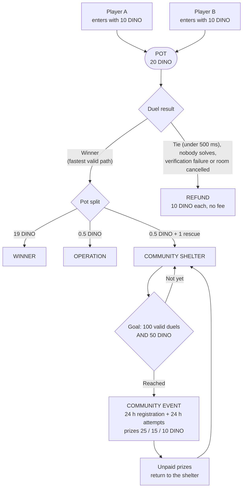

# Dino Escape — test-DINO prototype

A skill game where a memecoin is **spent by playing**, and part of every match funds community prizes.
Built for the NEAR Hackathon (track 11, "The joke needs rules").

> **Honest status.** This is a playable prototype. All DINO is **test DINO with no real value**, balances are
> simulated by an authoritative server, and **there is no smart contract yet** (see [What is and is not on-chain](#what-is-and-is-not-on-chain)).
> DINO is a game currency, not an investment: nothing here promises price increases or profit.
> The game interface is in Spanish.

## The game

A path-building puzzle. A dinosaur starts at an exit and must reach its shelter. You get a limited set of pieces
(straight, curve, T, bridge) and a clock. Nine levels: 1–3 simple, 4–6 add T pieces, bridges and fixed paths,
7–9 have two dinosaurs at once. A path can fail in four ways: `cut`, `out_of_bounds`, `wrong_shelter`, `loop`.
The engine is deterministic (one step per 0.5 s tick) and the server re-simulates every submitted solution.

Modes:

- **Free practice** — no DINO involved.
- **1v1 duel** — both players get the same unseen level variant; the fastest valid path wins.
- **Community shelter + free event** — a share of every duel funds a shared pool that pays a free community challenge.

## Money flow (test DINO)



| Item | Value |
|---|---|
| Entry per player / pot | 10 / 20 DINO |
| Winner | 19 DINO |
| Operation + shelter | 0.5 + 0.5 DINO (5 % of the pot) |
| Shelter goal | 100 valid duels **and** 50 DINO |
| Event prizes | 25 / 15 / 10 DINO (50 total) |

Refunds are full and fee-free, and they add no rescue and no shelter funds: tie within 500 ms (measured by the
server), nobody solves, verification failure, room not completed in 5 minutes, or cancelled before the start.
Disconnecting does not stop the clock and does not hand the win to the opponent.

Accounting uses integers only (1 DINO = 100 units) with five pockets: available, locked, operation, shelter and
event reserve. Their sum always equals the total granted. Every settlement has a unique id, so nothing is paid twice,
and the shelter never pays out more than it holds.

## Run it

Requires Node.js 20 or newer.

```bash
npm install
npm start          # builds the client and serves everything at http://localhost:8787
```

For development, run the server and the client separately:

```bash
npm run server     # authoritative server (WebSocket, port 8787)
npm run dev        # client at http://localhost:5173 (proxies /ws to 8787)
```

To try a duel alone, open two tabs: `/?dev=1&as=Ana` and `/?dev=1&as=Beto` (each `as` value is a separate test identity).
Practice mode works without the server; duels, shelter, event and balances need it.

## Verify it

```bash
npm run validate   # 288 engine/level checks + 102 server checks (settlements, refunds, event)
npm run e2e        # a real two-client duel against a running server
```

## Architecture

| Layer | Where | What it does |
|---|---|---|
| Game engine | `src/game/` | Pieces, paths, failures, game session. No React; shared by client and server. |
| Levels | `src/levels/` | Nine levels with reference solutions; `variants.ts` builds unseen, solver-verified variants. |
| Server | `server/` | `world.ts` (rooms, shelter, event), `ledger.ts` (integer double-entry ledger), `validate.ts` (checks solutions), `index.ts` (HTTP + WebSocket). |
| NEAR interfaces | `server/ports.ts` | Identity, balances, escrow and treasury interfaces meant to be replaced by NEAR contracts. |
| Client | `src/ui/`, `src/net/` | Draws the game (SVG) and sends actions. It never decides winners or amounts. |

All money rules live in `server/config.ts`: entry, fees, tie margin, room wait, shelter goal, prizes and deadlines.

Dev mode (`?dev=1`, only against a development server) opens any level, shows solutions, grants test balance,
preloads the shelter to 99 rescues / 49.5 DINO (labelled as a demo) and speeds up event deadlines.

## What is and is not on-chain

Nothing is on-chain today. The money rules are enforced by the server's ledger, not by a contract, so a server
operator could change them. The track asks for rules enforced by a contract with no admin key; the plan for that
(a NEP-141 token plus a contract for duels and the shelter, with the server acting only as a result oracle that can
choose between "A wins", "B wins" or "refund") is future work, and it will live in a separate `chain/` folder
marked experimental. Even then, who solved the puzzle is decided off-chain, so the contract would trust the server's key.

## Known limits

- State is kept in memory and saved to `server/data/state.json`. Rooms do not survive a server restart (locked funds are refunded).
- Reconnecting keeps the clock and the room, but reloading the page loses a half-built board.
- Rate limits, plausible-time checks and a rejection log catch impossible results; they do not stop bots or outside help.
- One event attempt per account does not stop people from creating several accounts.
- A duel with an entry fee and a pot may fall under gambling rules in some countries if real money is used; that is why this is a test-currency prototype.
